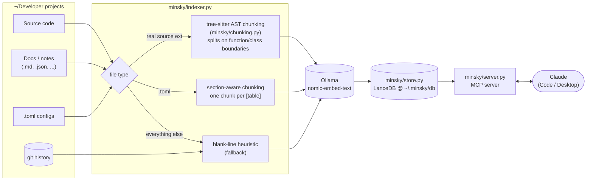
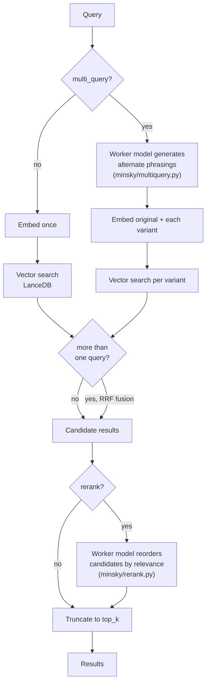

# Minsky

A local RAG layer over your `~/Developer` projects (code, docs, personal notes, git history), exposed as an MCP server so Claude can search it directly.

- Embeddings: local, via [Ollama](https://ollama.com) (`nomic-embed-text`) - nothing leaves your machine.
- Vector store: [LanceDB](https://lancedb.github.io/lancedb/), embedded (`~/.minsky/db`), no server to run.
- Indexing is incremental: unchanged files are skipped on re-index via a content-hash sidecar.
- Retrieval quality is opt-in tunable (reranking, multi-query fusion) and measurable (`minsky eval`), not just assumed.

## Architecture

Two independent pipelines, both local-first - embeddings and worker-model calls go to a locally-running Ollama, never a cloud API.



A second, independent CLI path (`minsky delegate`) sends boilerplate/bulk tasks straight to a local worker model, with no involvement from the index or LanceDB at all - see [Delegating boilerplate/bulk work](#delegating-boilerplatebulk-work).

### Retrieval: the `search()` request flow

Both `rerank` and `multi_query` are opt-in and off by default (each adds a worker-model round trip), and they compose - multi-query's fused candidates can be reranked before truncating to `top_k`.



### Measured impact of each retrieval mode

Real numbers from `minsky eval` against this repo's own 24-case `evalset.toml` (2026-11-24) - not illustrative, the actual before/after:

| Mode | hit@1 | hit@3 | hit@5 | hit@10 | MRR | ndcg@3 |
|---|---|---|---|---|---|---|
| vector only (default) | 71% | 88% | 92% | 96% | 0.784 | 0.784 |
| `--multi-query` (RRF fusion) | 67% | 75% | 92% | 96% | 0.741 | 0.692 |

`--multi-query` is a net regression on this evalset: a well-phrased query already has a strong single-embedding hit, so worker-model paraphrases mostly dilute it rather than widen the net. It stays in the codebase as opt-in (default off everywhere) rather than being ripped out, since an earlier hybrid vector+FTS experiment showed the same regression pattern and was reverted outright when it wasn't opt-in.

## Setup

Fastest path is pasting `SETUP_PROMPT.md`'s content into your own Claude Code/Codex session to have it bootstrap everything automatically, OR doing it manually (install Ollama, pull `nomic-embed-text`, `pip install -e .`). We recommend using `gpt-oss:20b` or `qwen2.5-coder:14b` as the worker model; either requires at least 13 GB of free RAM, while `qwen2.5-coder:7b` is a lighter fallback for machines with less RAM. Configuration lives in `minsky.toml` - edit `[index] roots` / `extra_projects` to change what gets indexed, and `[git]` to toggle commit history indexing. The `roots` setting should point at your own code (e.g. `~/Projects` or `~/Developer`, not assuming either specifically).

## Usage

```
.venv/bin/minsky projects        # list discovered projects
.venv/bin/minsky index           # index everything configured
.venv/bin/minsky index --project Foo   # index just one project
.venv/bin/minsky search "why did we switch to X"
.venv/bin/minsky search "why did we switch to X" --rerank --multi-query   # slower, see above
.venv/bin/minsky compact         # compact LanceDB, reclaim disk space
.venv/bin/minsky eval            # score retrieval against evalset.toml
```

Re-run `minsky index` whenever you want the index refreshed (e.g. via cron, or by hand after a work session).

### Delegating boilerplate/bulk work

`minsky delegate` sends a task to a local worker model (configured in
`minsky.toml`'s `general.worker_model`, currently `gpt-oss:20b`, via
Ollama) instead of doing it yourself - useful for boilerplate, scaffolding,
and other bulk/mechanical output where a smaller model's first draft is
good enough to review rather than write from scratch. The worker model has been evaluated with several options. `qwen2.5-coder:14b` was the default, but a head-to-head test with three compiled/executed prompts found it introduced a real data-corruption bug on a non-trivial task, whereas `gpt-oss:20b` produced correct results with less review burden. A `qwen2.5-coder:32b` variant was also evaluated; it had the same failure rate as 14B on every real task, used roughly twice the memory (~24 GB vs ~12 GB resident) and had twice the latency, so it was not retained. Every call is logged (prompt, context, response, timing) to `~/.minsky/delegate_logs/`.

```
.venv/bin/minsky delegate "Write a Python dataclass for a User with id, email, created_at"
.venv/bin/minsky delegate --prompt-file task.md --context existing_module.py --out draft.py
.venv/bin/minsky delegate "..." --model qwen2.5-coder:7b   # override with any model pulled in Ollama
```

The worker model is not as capable as a frontier model - treat its output as a first draft that still needs review, not a finished result.

By default `delegate` streams the live prompt/response exchange to stderr as
it happens (pass `--quiet` to suppress it; stdout always just carries the
final response, so piping/`--out` stay clean). Every conversation is also
logged to `~/.minsky/delegate_logs/`, browsable later:

```
.venv/bin/minsky log --list        # one-line-per-conversation summary
.venv/bin/minsky log --last 5      # full transcripts of the last 5 calls
.venv/bin/minsky log               # every conversation, full transcript
```

### Measuring retrieval quality

Retrieval can get quietly worse - a chunk-size tweak, a different embedding
model, or just a stale index - and search output looks equally confident either
way. `minsky eval` puts a number on it.

`evalset.toml` at the repo root holds the cases. Each one is a query plus the
path(s) a correct answer must surface:

```toml
[[case]]
name = "embeddings-call"
query = "where are text embeddings generated"
expect = ["minsky/ollama_client.py"]
project = "minsky_ai"  # optional
kind = "code"          # optional: code | doc | note | git
```

```
.venv/bin/minsky eval                           # hit@1/3/5/10 + MRR + nDCG@1/3/5/10
.venv/bin/minsky eval --verbose                 # for misses, show what came back instead
.venv/bin/minsky eval --case embeddings-call    # one case (repeatable)
.venv/bin/minsky eval --save baseline.json      # record the current state
.venv/bin/minsky eval --compare baseline.json   # diff against it, per case
.venv/bin/minsky eval --fail-under 0.8          # non-zero exit for cron/hooks
.venv/bin/minsky eval --multi-query             # score the multi-query retrieval path instead
.venv/bin/minsky eval --judge                   # LLM-as-judge pass, see below
```

nDCG@k is graded rather than binary like hit@k: it rewards a relevant hit
ranking earlier, and rewards more of a case's multiple acceptable paths
showing up in the same top-k window, a detail hit@k's first-match-only rank
otherwise collapses away.

`--judge` asks the worker model whether the #1 result's actual content would
answer the query, independent of whether its path matched `expect` - a check
on hit@k itself, not a replacement for it. It catches two blind spots
hit@k's path-matching can't see on its own: a path match that lands on the
wrong chunk of the right file, and a path miss where the content was fine but
lived somewhere `expect` never named. Disagreements between path-matching and
the judge print separately from the main report; a judge call that errors or
returns something unparseable counts as neither a pass nor a fail.

The `--compare` output names each case that moved, and flags `REGRESSED` for any
that dropped out of the window entirely - so a change that raises the average
while breaking three specific lookups doesn't slip through.

Before scoring, `eval` checks the two things that fail silently: a case pointing
at a project that was never indexed (which can only ever miss), and an
`index_state.json` older than 24 hours. Both print a `warning:` to stderr so a
miss isn't mistaken for bad retrieval.

Add cases from queries you actually typed. Twenty invented queries prove less
than five real ones.

### Evaluation metrics explained

The following metrics are used to evaluate retrieval performance. They are
described in plain language:

- **rank**: the 1-based position of the first relevant/expected result in the
  returned list; a case that never appears in the results has no rank (a miss).
- **hit@k**: whether a relevant result landed anywhere in the top k results
  - a yes/no per case, averaged into a percentage across all cases.
- **MRR (Mean Reciprocal Rank)**: the average of `1/rank` across all cases
  (a miss counts as 0). It rewards a correct result ranking **higher**, not
  just appearing somewhere in the window: rank 1 scores 1.0, rank 2 scores 0.5,
  rank 4 scores 0.25, a miss scores 0 - unlike hit@k, which treats rank 1
  and rank k as equally good as long as both are "in the window."
- **nDCG (normalized Discounted Cumulative Gain)**: graded rather than binary -
  rewards a relevant hit ranking earlier, and rewards more of a case's
  multiple acceptable paths showing up in the same top-k window, a detail
  hit@k's first-match-only rank otherwise collapses away.

```
MRR = (1/1 + 1/2 + 0) / 3 = 0.5
```

Refer to the evaluation table earlier in this README to verify the reported
MRR and nDCG numbers using this definition.

## Wiring into Claude Code / Claude Desktop

Add Minsky as an MCP server, e.g. in Claude Code:

```
claude mcp add minsky -- /path/to/minsky_ai/.venv/bin/minsky mcp
```

or in Claude Desktop's `claude_desktop_config.json`:

```json
{
  "mcpServers": {
    "minsky": {
      "command": "/path/to/minsky_ai/.venv/bin/minsky",
      "args": ["mcp"]
    }
  }
}
```

This exposes three tools: `search(query, project?, kind?, top_k?, rerank?, multi_query?)`, `list_projects()`, and `list_configured_projects()`.

## Known limitations (v1)

- Chunking is AST-aware for real source code (via [tree-sitter](https://tree-sitter.github.io/tree-sitter/), splitting on function/class/definition boundaries rather than blank lines); `.toml` gets its own section-aware chunking (one chunk per `[table]`); everything else (`.md`, `.json`, ...) falls back to a blank-line heuristic, as does any file the parser can't handle.
- `--multi-query` is implemented and composes with `--rerank`, but measurably regresses retrieval on this repo's own evalset (see the table above) - it's opt-in and off by default for that reason, not because it's unfinished.
- `--judge`'s worker-model verdicts are a second opinion, not ground truth - treat disagreements as something to spot-check, not an automatic correction to `expect`.
- Git indexing covers commit messages only (no diffs) to keep indexing fast.
- `.gitignore` is only read from each project's root, not nested ones.
- No file-watcher yet - indexing is on-demand (`minsky index`), not live.